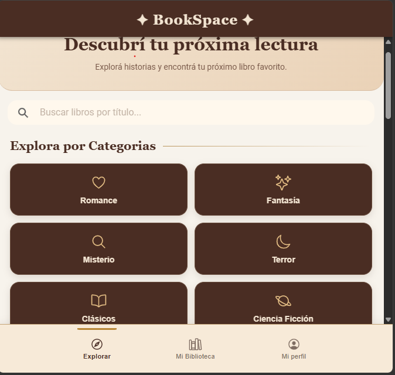
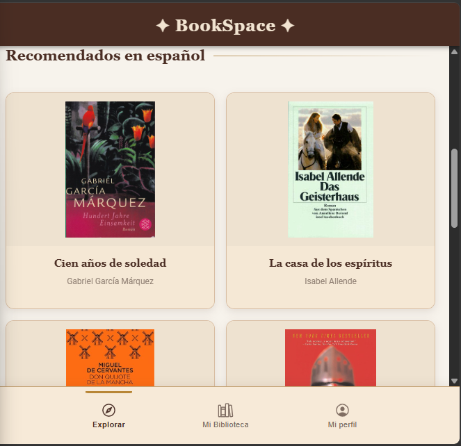
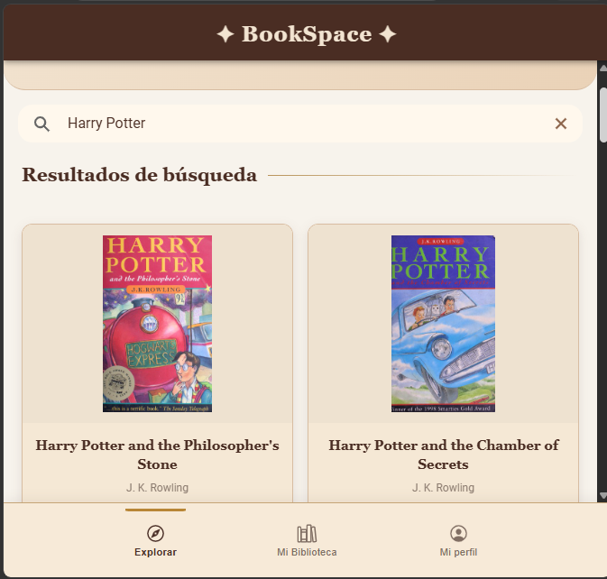
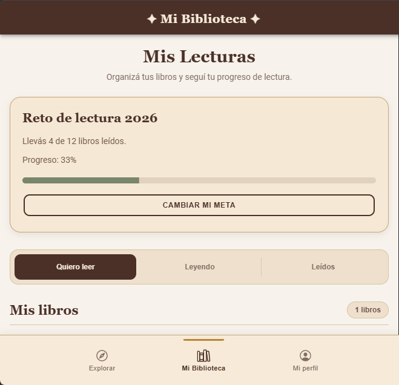
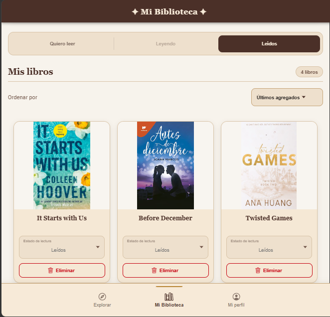
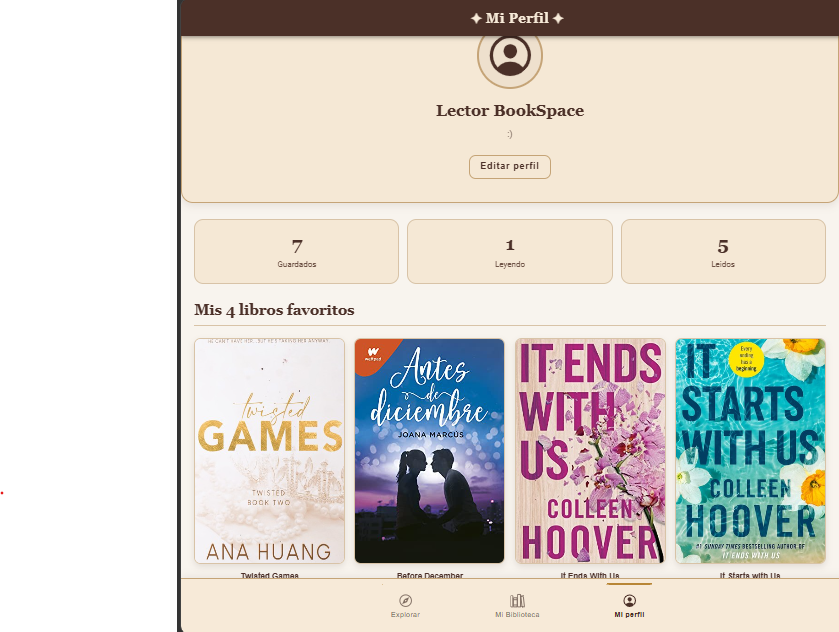
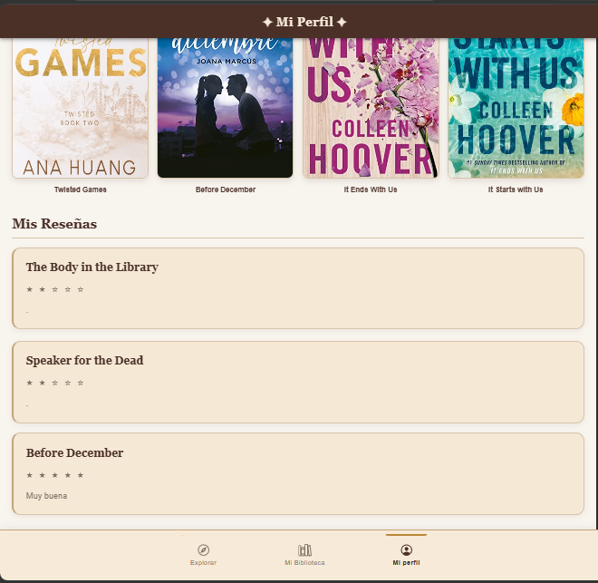
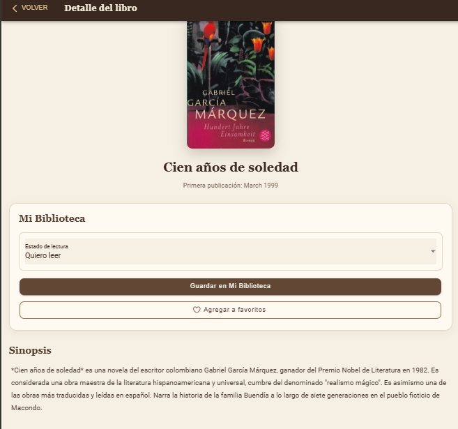
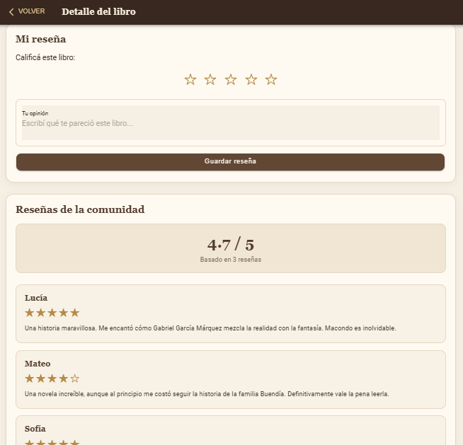

# BookSpace

**Tu espacio para descubrir, organizar y compartir lecturas.**

BookSpace es una aplicación desarrollada como proyecto universitario para la asignatura **Programación VI**.

Inspirada en plataformas como Letterboxd, pero enfocada en libros, permite descubrir nuevas lecturas, organizar una biblioteca personal, calificar libros, escribir reseñas y consultar opiniones de otros lectores.

La aplicación presenta una interfaz inspirada en la estética *Dark Academia*, con tonos cálidos, marrones, crema y detalles dorados.

BookSpace funciona como aplicación web y también cuenta con una versión para dispositivos Android mediante Capacitor.

## Información del proyecto

- **Proyecto:** BookSpace
- **Asignatura:** Programación VI
- **Desarrolladora:** Yenifer López
- **Año:** 2026
- **Tipo:** Aplicación web y Android desarrollada con Ionic, Angular y Capacitor

## Funcionalidades

### Tab 1 — Explorar

Es la primera pestaña de la aplicación, identificada con el ícono de una brújula.

Permite:

- Buscar libros por título utilizando Open Library API.
- Descubrir libros recomendados en español.
- Explorar categorías literarias como romance, fantasía, misterio, terror, clásicos y ciencia ficción.
- Consultar información detallada de cada libro.
- Acceder a la página de detalle para guardar libros, calificarlos y consultar reseñas.

**Archivo principal:** `src/app/tab1/`

### Tab 2 — Mi Biblioteca

Es la segunda pestaña, identificada con el ícono de libros.

Permite:

- Guardar libros en una biblioteca personal.
- Organizar las lecturas en tres estados: **Quiero leer**, **Leyendo** y **Leídos**.
- Cambiar el estado de lectura de los libros.
- Ordenar los libros por título o fecha de incorporación.
- Eliminar libros de la biblioteca.
- Establecer una meta anual de lectura.
- Consultar el progreso mediante una barra de avance.

**Archivo principal:** `src/app/tab2/`

### Tab 3 — Mi Perfil

Es la tercera pestaña, identificada con el ícono de usuario.

Permite:

- Visualizar un perfil de lector.
- Editar el nombre y la biografía.
- Guardar la información del perfil mediante `localStorage`.
- Consultar estadísticas de libros guardados, leyendo y leídos.
- Visualizar hasta cuatro libros favoritos.
- Consultar las reseñas y calificaciones personales.

**Archivo principal:** `src/app/tab3/`

### Detalle del libro y reseñas

Además de las tres pestañas principales, BookSpace incluye una página de detalle para cada libro.

Desde esta pantalla es posible:

- Consultar la portada, el título, información bibliográfica y la sinopsis.
- Agregar libros a la biblioteca personal.
- Seleccionar un estado de lectura.
- Agregar o quitar libros de favoritos.
- Calificar libros de 1 a 5 estrellas.
- Escribir y guardar reseñas personales.
- Consultar reseñas de una comunidad ficticia.
- Visualizar el promedio de las calificaciones de la comunidad.

**Archivo principal:** `src/app/pages/book-detail/`

## Tecnologías utilizadas

| Tecnología       | Uso                                              |
| ---------------- | ------------------------------------------------ |
| Angular          | Componentes, servicios y lógica de la aplicación |
| Ionic Framework  | Interfaz y navegación por pestañas               |
| Capacitor        | Integración de la aplicación web con Android     |
| TypeScript       | Desarrollo de funcionalidades                    |
| HTML             | Estructura de las páginas                        |
| SCSS             | Estilos y diseño Dark Academia                   |
| Open Library API | Información bibliográfica                        |
| JSON             | Datos ficticios de la comunidad                  |
| localStorage     | Persistencia de datos personales                 |
| Vitest           | Pruebas unitarias                                |
| Git y GitHub     | Control de versiones y repositorio               |

## Fuente de datos

BookSpace utiliza la **Open Library API** para obtener información sobre libros, incluyendo títulos, autores y portadas.

**Documentación oficial:** [https://openlibrary.org/developers/api](https://openlibrary.org/developers/api)

También utiliza archivos JSON locales para representar una comunidad ficticia de lectores y sus reseñas.

Estos datos permiten simular opiniones de otros lectores sin implementar una base de datos ni un sistema de autenticación.

## Almacenamiento de datos

BookSpace no utiliza una base de datos ni requiere inicio de sesión.

La información personal se almacena mediante `localStorage`, incluyendo:

- Libros guardados.
- Estados de lectura.
- Favoritos.
- Reseñas y calificaciones personales.
- Nombre y biografía del perfil.
- Preferencias y meta de lectura.

Los datos permanecen disponibles en la misma instalación de la aplicación mientras no se elimine su almacenamiento local.

**Limitación:** la información no se sincroniza entre dispositivos. Cada navegador o instalación mantiene sus propios datos.

## Instalación y ejecución

### 1. Requisitos previos

Para ejecutar BookSpace en un entorno de desarrollo es necesario contar con:

- Node.js y npm.
- Git.
- Un navegador web moderno.

También se recomienda disponer de Angular CLI e Ionic CLI.

### 2. Instalar Node.js y npm

Descargar e instalar la versión LTS de Node.js desde:

[https://nodejs.org/](https://nodejs.org/)

npm se instala junto con Node.js.

Para comprobar la instalación, ejecutar en una terminal:

```bash
node -v
npm -v
```

Ambos comandos deben mostrar sus respectivas versiones.

### 3. Instalar Git

Descargar Git desde:

[https://git-scm.com/downloads](https://git-scm.com/downloads)

Comprobar la instalación:

```bash
git --version
```

### 4. Instalar Angular CLI

Ejecutar:

```bash
npm install -g @angular/cli
```

Verificar la instalación:

```bash
ng version
```

### 5. Instalar Ionic CLI

Ejecutar:

```bash
npm install -g @ionic/cli
```

Verificar la instalación:

```bash
ionic --version
```

### 6. Clonar el repositorio

Ejecutar:

```bash
git clone https://github.com/Yeni131/bookspace.git
```

Este comando descarga el proyecto desde GitHub.

### 7. Ingresar a la carpeta del proyecto

```bash
cd bookspace
```

### 8. Instalar las dependencias

```bash
npm install
```

Este comando instala las dependencias declaradas en el archivo `package.json`.

No es necesario crear un nuevo proyecto Ionic o Angular.

### 9. Ejecutar la aplicación

```bash
ionic serve
```

La aplicación estará disponible normalmente en:

[http://localhost:8100](http://localhost:8100)

Para detener el servidor de desarrollo, presionar `Ctrl + C` en la terminal.

## Pruebas y compilación

### Ejecutar pruebas unitarias

```bash
npm run test:unit
```

El proyecto utiliza Vitest para ejecutar pruebas automatizadas.

En una verificación anterior se completaron correctamente **12 de 12 pruebas**. Este resultado corresponde a dicha ejecución y no sustituye una nueva comprobación después de realizar cambios.

### Compilar el proyecto

```bash
npm run build
```

Este comando genera la versión compilada de la aplicación.

Los archivos resultantes se generan en la carpeta `www/`.

Durante la compilación pueden aparecer advertencias relacionadas con Sass, navegadores antiguos o tamaños de archivos de estilos, sin impedir que el proceso finalice correctamente.

La compilación se utilizó durante el desarrollo para verificar que los cambios realizados no introdujeran errores de construcción.

## Versión Android

BookSpace también cuenta con una versión para dispositivos Android, desarrollada mediante **Capacitor**.

Se generó una APK de depuración (`app-debug.apk`), que fue instalada y probada en un dispositivo Android.

La aplicación incluye un ícono personalizado y se identifica con el nombre **BookSpace**.

### Generación de la APK

Para preparar la versión Android desde el proyecto:

1. Compilar la aplicación web:

```bash
npm run build
```

2. Sincronizar los archivos con Android:

```bash
npx cap sync android
```

3. Ingresar al directorio Android:

```bash
cd android
```

4. Generar la APK de depuración en Windows:

```powershell
.\gradlew.bat assembleDebug --no-daemon --max-workers=1 --no-parallel
```

Una vez completada la compilación, el archivo se encuentra en:

`android/app/build/outputs/apk/debug/app-debug.apk`

La APK puede instalarse en dispositivos Android compatibles, habilitando la instalación desde la fuente correspondiente cuando sea necesario.

### Descarga de la APK

La versión Android de BookSpace cuenta con una APK de depuración disponible para su distribución mediante la sección **Releases** del repositorio de GitHub.

**Repositorio:** [https://github.com/Yeni131/bookspace](https://github.com/Yeni131/bookspace)

**Releases:** [https://github.com/Yeni131/bookspace/releases](https://github.com/Yeni131/bookspace/releases)


## Capturas de pantalla

Las siguientes imágenes muestran las principales pantallas y funcionalidades de BookSpace.

### Tab 1 — Explorar

**Categorías literarias y buscador**



**Libros recomendados en español**



**Búsqueda de libros mediante Open Library API**



### Tab 2 — Mi Biblioteca

**Reto anual de lectura y seguimiento del progreso**



**Libros guardados en la categoría Leídos**



### Tab 3 — Mi Perfil

**Perfil del lector, estadísticas y favoritos**



**Reseñas y calificaciones personales**



### Detalle del libro

**Información del libro y opciones de biblioteca**



**Calificaciones y reseñas de la comunidad**




## Uso de inteligencia artificial

Durante el desarrollo de BookSpace se utilizó **ChatGPT (OpenAI)** como herramienta de apoyo para la programación, resolución de errores y mejoras de diseño .

Los detalles sobre su utilización se encuentran en el archivo [`IA.md`](IA.md).

## Estado del proyecto

Las principales funcionalidades de BookSpace se encuentran implementadas.

Se realizaron verificaciones manuales, compilaciones exitosas y pruebas unitarias durante el desarrollo.

También se generó e instaló una versión Android de depuración para comprobar su funcionamiento en un dispositivo físico.

El proyecto cuenta con las funcionalidades principales desarrolladas y la documentación correspondiente para su entrega académica.

---

**BookSpace — Proyecto individual de Programación VI, 2026.**

**Desarrollado por Yenifer López.**
